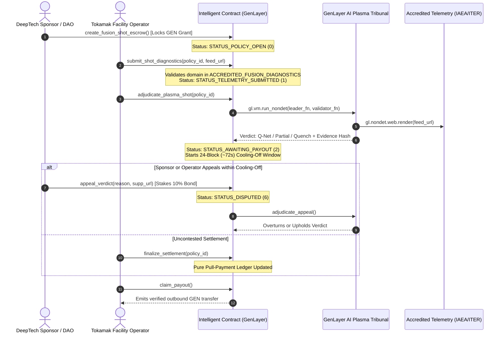
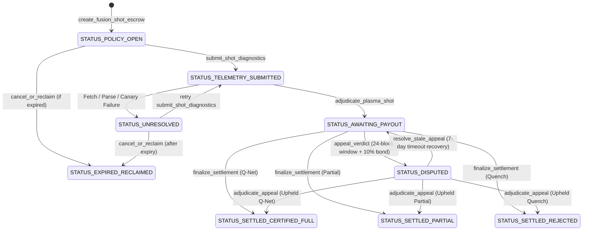

# ⚛️ Technical Architecture — AgentFusionPurity

**AgentFusionPurity** is an autonomous magnetic confinement fusion plasma and tritium breeding oracle built natively on **GenLayer StudioNet (Chain ID: 61999)**.

---

## 🔬 System Overview & Problem Statement

Nuclear fusion energy research facilities (such as Tokamaks, Stellarators, and Magnetized Target Fusion experiments including ITER, SPARC/CFS, WEST, and JET) invest millions of dollars into experimental fuel subsidies and high-temperature plasma confinement trials.

When DeepTech sponsors, research foundations, or fuel vendors escrow grants for net-energy ($Q > 1.0$) pulse shots, traditional EVM smart contracts cannot inspect raw physics diagnostics:
1. **Soft X-Ray Spectroscopy:** Monitoring impurity radiation and core electron temperatures.
2. **Laser Interferometry:** Line-integrated electron density ($n_e$) measurements.
3. **Neutron Spectrometry & Lithium Blanket Sensors:** Verifying Tritium Breeding Ratio ($\text{TBR} \ge 1.05$) for closed-cycle fuel sustainability.
4. **MHD Disruption Warning Systems:** Catching thermal quenches and runaway electron avalanches.

**GenLayer Intelligent Contracts** bridge this gap by enabling non-deterministic web rendering (`gl.nondet.web.render`) and multi-validator AI consensus (`gl.vm.run_nondet`) to parse accredited diagnostic feeds directly on-chain.

---

## 🏛️ End-to-End Protocol Flow



---

## 📊 Parametric Lawson Decision Matrix

```
                                 [ Shot Telemetry Submitted ]
                                               │
                                               ▼
                              Did Major Thermal Quench Occur?
                              OR tau_E < min_confinement / 2?
                                        │               │
                                       YES              NO
                                        │               │
                                        ▼               ▼
                        [ PLASMA_DISRUPTION_QUENCH ]   Is tau_E >= min_confinement
                        - 100% escrow refunded         AND Q >= target_q
                          to sponsor fund              AND TBR >= 1.05?
                                                        │              │
                                                       YES             NO
                                                        │              │
                                                        ▼              ▼
                                     [ FUSION_Q_NET_CERTIFIED ]   [ PARTIAL_CONFINEMENT ]
                                     - 100% research grant        - 40% fuel grant released
                                       released to tokamak          to tokamak facility
                                       facility operator          - 60% refunded to sponsor
```

---

## 🛡️ Security Architecture & Non-Settling State Machine



---

## 💻 Tech Stack Summary

- **Contract Layer:** Python Intelligent Contract (`py-genlayer` pragma, `TreeMap`, `gl.nondet.web.render`, `gl.vm.run_nondet`).
- **Chain:** GenLayer StudioNet (`61999` / `0xF22F`).
- **Frontend:** React 18, TypeScript, Vite, TailwindCSS, Lucide Icons, HTML5 Canvas.
- **Testing:** Pytest, GenLayer Test Harness (`gltest`).
