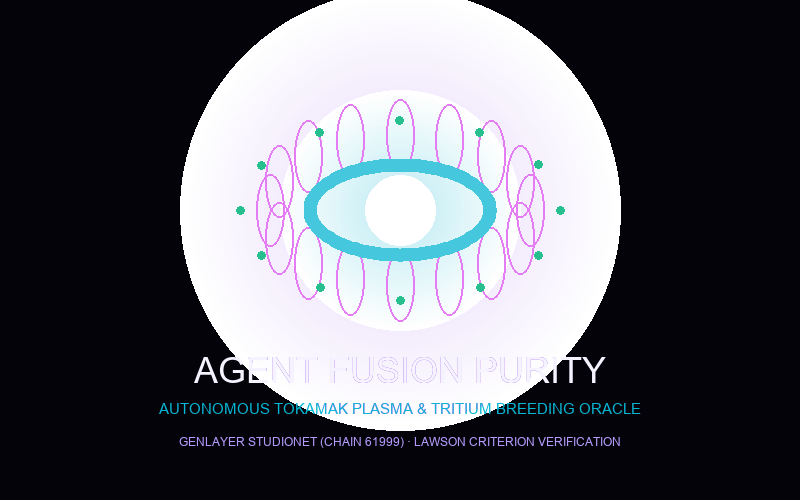

# ⚛️ AgentFusionPurity
### Autonomous Magnetic Confinement Fusion Plasma & Tritium Breeding Oracle

[-06B6D4?style=for-the-badge&logo=ethereum)](https://studio.genlayer.com)
[](https://github.com/genlayer)
[](LICENSE)
[](https://agentfusionpurity.vercel.app)

---

<p align="center">
  
</p>

## 📌 Executive Summary

**AgentFusionPurity** is a decentralized deep-tech oracle and research grant escrow protocol designed for the experimental nuclear fusion industry (Tokamaks, Stellarators, and Magnetized Target Fusion reactors such as ITER, SPARC/CFS, WEST, and JET).

Nuclear fusion facilities spend tens of millions of dollars procuring isotope fuels (Deuterium and Tritium, $^3\text{H}$) and testing high-temperature magnetic confinement configurations. When sponsors or research grants escrow capital for net-energy pulse runs ($Q > 1.0$), crucial verification criteria include:

1. **Plasma Disruption Avoidance:** Mitigating magnetohydrodynamic (MHD) instabilities, avoiding runaway electron avalanches, and sustaining core ion temperatures ($T_i \ge 100\text{M }^\circ\text{C}$ or $\ge 8.6\text{ keV}$).
2. **Tritium Breeding Ratio (TBR):** Ensuring $\text{TBR} \ge 1.05$ from lithium blanket systems to guarantee closed-cycle fuel self-sufficiency.
3. **Lawson Criterion Triple Product:** Verifying steady-state energy confinement time $\tau_E$ without thermal quenches.

Traditional EVM smart contracts cannot read or parse soft X-ray spectrometry, laser interferometer electron density, or neutron diagnostic data feeds. Built natively on **GenLayer**, AgentFusionPurity leverages non-deterministic web rendering (`gl.nondet.web.render`) and multi-validator AI consensus (`gl.vm.run_nondet`) to autonomously cross-examine plasma shot diagnostics from accredited international atomic authorities.

---

## 🏛️ Deployed Contract Information (GenLayer StudioNet)

| Property | Value |
|---|---|
| **Network** | GenLayer StudioNet |
| **Chain ID** | `61999` (Hex: `0xF22F`) |
| **RPC Endpoint** | `https://studio.genlayer.com/api` |
| **Contract Address** | `0x077c23EA77BDA377B0f92079aDdfc945845c51c0` |
| **Explorer / Studio** | [View on GenLayer Studio](https://studio.genlayer.com/address/0x077c23EA77BDA377B0f92079aDdfc945845c51c0) |
| **Production dApp** | [https://agentfusionpurity.vercel.app](https://agentfusionpurity.vercel.app) |

---

## ⚡ Key Architectural Innovations

1. **Autonomous AI Plasma Tribunal:**  
   GenLayer validators independently fetch and digest live spectrometry, bolometer, and neutron diagnostic feeds using `gl.nondet.web.render`.
2. **Deterministic On-Chain Guardrails:**  
   The LLM extracts physical parameters with security canary verification (`CANARY_AGENT_FUSION_PURITY_V1`), while final financial verdicts are executed by deterministic Python logic.
3. **Accredited Fusion Source Whitelist (`ACCREDITED_FUSION_DIAGNOSTICS`):**  
   Strict domain enforcement restricts telemetry inputs strictly to:
   - International Atomic Energy Agency (`iaea.org`)
   - ITER Organization (`iter.org`)
   - US Department of Energy (`energy.gov`)
   - Culham Centre for Fusion Energy / CCFE (`ccfe.ukaea.uk`)
   - Max Planck Institute for Plasma Physics (`ipp.mpg.de`)
   - Commonwealth Fusion Systems (`cfs.energy`)
   - Fusion Energy Sciences (`fusionenergysciences.org`)
   - Oak Ridge National Laboratory (`ornl.gov`)
4. **Pure Pull-Payment Ledger:**  
   Internal balance accounting (`_credit_payout` and `claim_payout`) completely eliminates reentrancy vulnerabilities and prevents locked funds upon transfer reverts.
5. **Non-Settling Protected State (`STATUS_UNRESOLVED`):**  
   Transient network timeouts or malformed JSON payloads never trigger wrongful forfeiture; funds remain secured until retried or recovered.
6. **24-Block Cooling-Off Challenge & 7-Day Bounded Stale Recovery:**  
   Stakeholders can challenge an adjudication within 24 blocks (~72s) with a 10% staked dispute bond. If an appeal stalls, a bounded 7-day timeout allows anyone to recover 100% of the dispute bond back to the appellant.

---

## 📐 Parametric Decision Matrix

```
                              [ Shot Telemetry Submitted ]
                                            │
                                            ▼
                           Did Major Thermal Quench Occur?
                           OR tau_E < min_confinement / 2?
                                     │               │
                                    YES              NO
                                     │               │
                                     ▼               ▼
                     [ PLASMA_DISRUPTION_QUENCH ]   Is tau_E >= min_confinement
                     - 100% escrow refunded         AND Q >= target_q
                       to sponsor fund              AND TBR >= 1.05?
                                                     │              │
                                                    YES             NO
                                                     │              │
                                                     ▼              ▼
                                  [ FUSION_Q_NET_CERTIFIED ]   [ PARTIAL_CONFINEMENT ]
                                  - 100% research grant        - 40% fuel grant released
                                    released to tokamak          to tokamak facility
                                    facility operator          - 60% refunded to sponsor
```

---

## 🛠️ Repository Structure

```
AgentFusionPurity/
├── contracts/
│   └── contract.py                 # Intelligent Contract (py-genlayer pragma)
├── tests/
│   ├── conftest.py                 # Multi-validator mock test harness
│   ├── test_agentfusionpurity.py   # Main lifecycle & parametric tests
│   └── test_agentfusionpurity_runtime.py # Security & runtime edge cases
├── scripts/
│   ├── deploy_studionet.py         # Automated deployment to StudioNet
│   ├── verify_lifecycle.py         # Standalone lifecycle verification
│   └── generate_logo.py            # High-resolution brand logo generator
├── frontend/
│   ├── package.json
│   ├── vite.config.ts
│   ├── tailwind.config.js
│   ├── index.html
│   └── src/
│       ├── main.tsx
│       ├── App.tsx
│       ├── config/genlayer.ts      # GenVM client & calldata serialization
│       ├── components/
│       │   ├── Navbar.tsx
│       │   ├── StatsOverview.tsx
│       │   ├── TokamakReactorRadar.tsx # Interactive HTML5 Canvas plasma visualizer
│       │   ├── CreatePolicyModal.tsx
│       │   ├── PolicyCard.tsx
│       │   ├── SubmitTelemetryModal.tsx
│       │   ├── SpectrometryInspectorModal.tsx
│       │   ├── AppealModal.tsx
│       │   └── PullPayoutButton.tsx
│       └── utils/formatters.ts
├── ARCHITECTURE.md
├── CHANGELOG.md
├── SECURITY.md
├── LICENSE
├── deployment.json
└── README.md
```

---

## 🚀 Quick Start Guide

### 1. Run Unit Tests (100% Pass)
```bash
pytest tests
```

### 2. Deploy to GenLayer StudioNet
```bash
python scripts/deploy_studionet.py
```

### 3. Launch the Frontend
```bash
cd frontend
npm install
npm run dev
```

---

## 📜 License

This project is licensed under the MIT License — see the [LICENSE](LICENSE) file for details.
